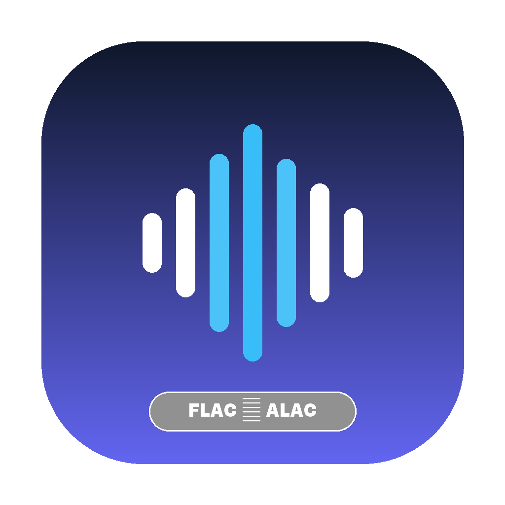

# 🎵 FlacToAlac

> **Modern, Lossless FLAC to ALAC (Apple Lossless M4A) Audio Converter with Drag & Drop.**

[](LICENSE)
[](https://python.org)
[]()
[]()

<p align="center">
  
</p>

---

## 🇹🇷 Türkçe Açıklama

**FlacToAlac**, FLAC müzik arşivinizi Apple ekosisteminde (Apple Music, iPhone, iPad, Mac, iPod) kayıpsız dinleyebilmeniz için **ALAC (.m4a)** formatına dönüştüren modern, hızlı ve açık kaynaklı bir masaüstü uygulamasıdır.

### ✨ Öne Çıkan Özellikler
* **Pencere Geneli Sürükle ve Bırak (Drag & Drop):** Dosyaları veya tüm müzik klasörlerini pencerenin herhangi bir yerine bırakmanız yeterli (iç içe alt klasörleri otomatik tarar).
* **%100 Bit-Perfect Kayıpsız Dönüşüm:** FLAC'tan ALAC'a geçerken ses kalitesinde en ufak bir kayıp veya yeniden sıkıştırma yaşanmaz.
* **Albüm Kapağı & Metadata Koruması:** Şarkı adı, sanatçı, albüm, parça sırası ve gömülü yüksek çözünürlüklü albüm kapakları (`covr`) eksiksiz korunur.
* **Hızlı Paralel Dönüştürme:** Çok çekirdekli (multi-thread) işlemci desteği, hız göstergesi (`X dosya/sn`) ve kalan süre (ETA) tahmini.
* **Apple Music Entegrasyonu:** Dönüştürülen parçaları tek tıkla doğrudan macOS Apple Music kütüphanesine aktarma seçeneği.
* **Zaten Dönüştürülmüşleri Atla (Skip Existing):** Hedef konumda zaten `.m4a` dosyası varsa zaman kaybetmeden atlar.
* **Kuyruk Yönetimi & Hata İnceleme:** `Delete` tuşu veya sağ tık ile listeden şarkı çıkarma; olası hatalarda satıra çift tıklayarak detaylı FFmpeg logunu görüp kopyalama.
* **Güvenli Orijinal Silme (Opsiyonel):** Dönüştürme %100 doğrulanıp tamamlandığında orijinal FLAC'i otomatik silme seçeneği.
* **Sıfır Kurulum Zahmeti:** Sistemde FFmpeg kurulu olmasa bile yerleşik motoruyla hemen çalışır.

### 🚀 Hızlı Başlangıç (macOS)
Terminali açıp proje klasöründe şu komutu çalıştırmanız yeterlidir:
```bash
./run.sh
```
*(Bu betik gereken ortamı otomatik hazırlar ve uygulamayı başlatır.)*

Veya manuel olarak:
```bash
python3 -m venv .venv
source .venv/bin/activate
pip install -r requirements.txt
python3 main.py
```

### 📦 Standalone macOS .app Paketleme
Uygulamayı çift tıklanabilir bağımsız bir macOS `.app` haline getirmek için:
```bash
./scripts/build_app.sh
```
Derlenen uygulama `dist/FlacToAlac.app` dizininde hazır olacaktır.

---

## 🇬🇧 English Description

**FlacToAlac** is a lightweight, high-performance desktop application designed to batch convert FLAC audio files into ALAC (Apple Lossless Audio Codec in `.m4a` container) with an intuitive drag-and-drop interface.

### ✨ Key Features
* **Window-Wide Drag & Drop:** Drop individual `.flac` files or entire album folders directly anywhere on the app.
* **Zero Quality Loss:** Converts from FLAC to ALAC bit-for-bit losslessly.
* **Full Metadata & Artwork Retention:** Preserves tags (Title, Artist, Album, Year, Track #) and embedded high-res cover art.
* **Multi-threaded Batch Processing:** Real-time speed (`files/sec`) and accurate Remaining Time (ETA) estimation.
* **Apple Music Integration:** Automatically import converted tracks into your macOS Apple Music library.
* **Skip Existing Files:** Skips tracks that have already been converted to save time on large libraries.
* **Queue Management & Error Inspection:** Remove selected items using the `Delete` key or right-click context menu; double-click any error to inspect full FFmpeg logs.
* **Safe Source Deletion (Optional):** Safely deletes source FLAC files only after destination files are verified.
* **Zero Configuration:** Bundles an automated FFmpeg fallback so no manual toolchain setup is needed.

---

## 🛠️ Requirements

* **Python:** 3.9 or higher
* **FFmpeg:** Automatically detected from system PATH, Homebrew, or bundled `imageio-ffmpeg`.

---

## 📄 License

This project is licensed under the [MIT License](LICENSE).
